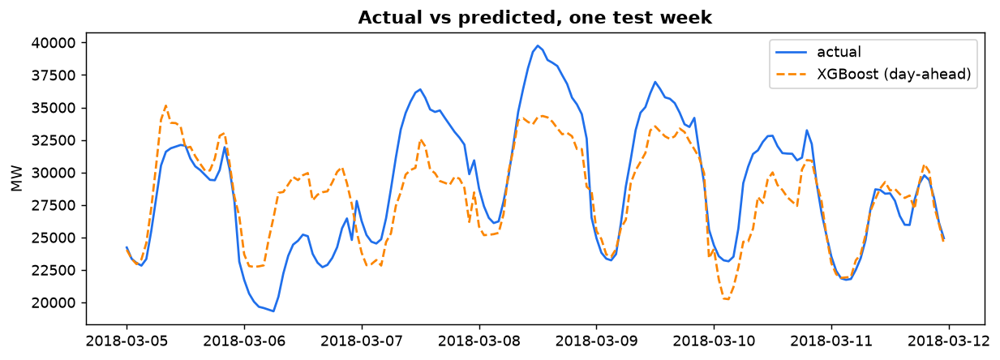
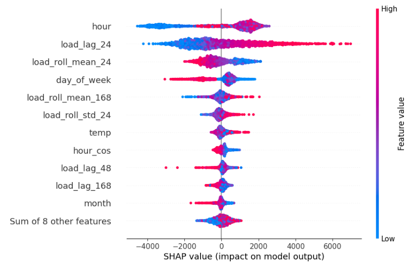
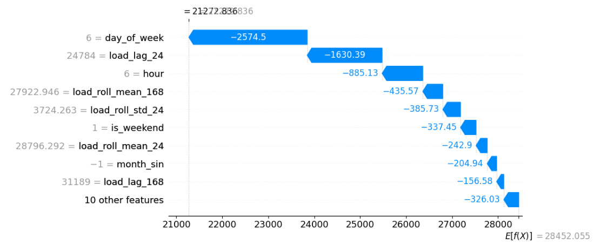

# ALICE Track A - Energy Forecasting & Optimization Platform

> **Team Lim** | Developed by **Lim Tze Chin** (Individual Project - Completed all parts)

An end-to-end energy analytics and battery storage dispatch system for ALICE Track A. The project integrates hourly load forecasting, model explainability (XAI), and battery cost-optimization into a decoupled full-stack application (FastAPI + Streamlit).

---

## Project Overview
- **Objective**: Accurately forecast hourly energy demand using historical load and meteorological features, analyze key feature drivers with XAI, and optimize battery storage charging/discharging schedules.
- **Key Deliverables**:
  - Full experimental pipeline: Data exploration, preprocessing, model benchmarking, and SHAP interpretability.
  - Production-ready FastAPI backend serving prediction & optimization APIs.
  - Interactive multi-page Streamlit dashboard for real-time monitoring and dispatch control.

---

## Key Results & Visualizations

### 1. Forecast vs. Actual Load
Evaluation of model performance across historical periods:
<p align="center">
  
</p>

### 2. Model Explainability (SHAP Analysis)
Feature attribution showing how weather factors (e.g., temperature) and cyclical lag features influence peak electricity demand:
<p align="center">
  
  
</p>

---

## Project Architecture

```
alice-track-a-team-Lim/
├── backend/                  # FastAPI Application
│   ├── artifacts/            # Exported XGBoost model (.joblib) & weather_hourly.csv
│   ├── sample_test/          # 2018 evaluation data slice for end-to-end testing
│   ├── services/             # Pipeline logic: preprocessing, forecasting, optimization
|   ├── README.md             # Project documentation
│   ├── config.py             # App configurations
│   ├── main.py               # REST API entry points
│   ├── requirements.txt      # Python dependencies
│   └── schemas.py            # Pydantic schemas
├── frontend/                 # Streamlit UI Dashboard
│   ├── components/           # Reusable widgets (cards, charts, sidebar)
│   ├── pages/                # Multi-page app (Overview, Forecasting, XAI, Optimization)
│   ├── utils/                # API client & formatting helpers
|   ├── README.md             # Project documentation
│   ├── app.py                # Dashboard entry point
│   └── requirements.txt      # Python dependencies
├── images/                   # Visualizations (EDA & SHAP charts)
├── models/                   # Persisted model pipeline (.joblib)
├── notebooks/                # Jupyter Notebooks 
|   ├── 01_data_exploration.ipynb          # EDA, frequency check, lag autocorrelation & dead columns
│   ├── 02_model_training.ipynb            # Pipeline fitting, baseline benchmarks, XGBoost selection
│   └── 03_explainability_and_export.ipynb # SHAP analysis, permutation importance, artifact export
├── .gitignore                # Git ignore rules
├── README.md                 # Project documentation
└── requirements.txt          # Python dependencies
```

---

## Dataset Access & Reproduction
The raw datasets are sourced from the Kaggle Energy Consumption & Weather Dataset (Spain):

Download **energy_dataset.csv** and **weather_features.csv** from https://www.kaggle.com/datasets/nicholasjhana/energy-consumption-generation-prices-and-weather.

Place both CSVs under data/.

Execute the notebooks sequentially:

- notebooks/01_data_exploration.ipynb

- notebooks/02_model_training.ipynb

- notebooks/03_explainability_and_export.ipynb

---

## How to Run

### 1. Clone & Install Dependencies
```
git clone [https://github.com/QingLTC/alice-track-a-team-Lim.git](https://github.com/QingLTC/alice-track-a-team-Lim.git)
cd alice-track-a-team-Lim

python -m venv .venv
# Windows:
.venv\Scripts\activate
# Linux/macOS:
# source .venv/bin/activate

pip install -r requirements.txt
```

### 2. Start the Backend API
```
cd backend
uvicorn main:app --host 127.0.0.1 --port 8000 --reload
```
- API Documentation (Swagger UI): http://127.0.0.1:8000/docs

### 3. Start the Frontend Dashboard
Open a new terminal tab (activate .venv first):
```
cd frontend
streamlit run app.py
```
- Dashboard URL: http://localhost:8501

---

## Contribution
Lim Tze Chin: Completed all parts independently
- Data Engineering: Data cleaning, frequency validation, physical anomaly clipping, cross-city weather aggregation, and leakage-proof lag generation.

- Machine Learning: Baseline implementations, hyperparameter tuning, model benchmarking (Ridge, HistGradientBoosting, XGBoost), and serialization of production artifacts.

- Model Explainability: Global feature importance and local SHAP decision breakdowns.

- Backend Architecture: FastAPI design with Pydantic schemas, lifespan artifact management, and input validation.

- Decision Support & Frontend: Linear programming (PuLP) cost & emission dispatch optimization and interactive Streamlit UI.
